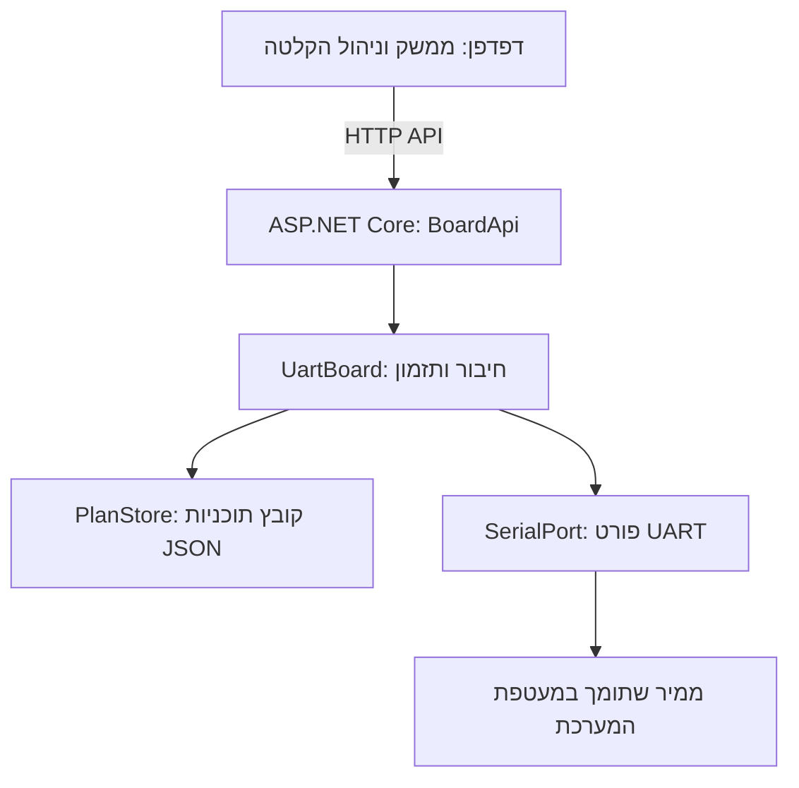

# Copilot 8

ממשק Web מקומי ליצירה, תזמון וניטור של הודעות ARINC 429 המועברות דרך חיבור UART, לניהול תוכניות שליחה ולהקלטת התעבורה.

הפרויקט כתוב ב־C# עם ASP.NET Core וב־HTML, CSS ו־JavaScript. שרת אחד מגיש את האתר, מנהל את הפורט הטורי ומבצע את התזמון. אין צורך להריץ שרת Frontend נפרד, להתקין Node.js לצורך השימוש או להקים מסד נתונים.

> התיעוד מתאר את הקוד שנבדק בתאריך 19.11.2026. זהו כלי סימולציה ובדיקות מקומי. לא כל הרשומות במילון כוללות קידוד מלא, ותזמון התוכנה אינו מבטיח דיוק של מיקרו־שניות.

## תוכן עניינים

- [היכולות הקיימות](#היכולות-הקיימות)
- [ארכיטקטורה וזרימת המידע](#ארכיטקטורה-וזרימת-המידע)
- [דרישות מקדימות](#דרישות-מקדימות)
- [התקנה והרצה ב־Windows](#התקנה-והרצה-בwindows)
- [התקנה והרצה ב־Linux](#התקנה-והרצה-בlinux)
- [שימוש במערכת](#שימוש-במערכת)
- [מקורות נתונים משתנים](#מקורות-נתונים-משתנים)
- [הקלטה ותצוגת תעבורה](#הקלטה-ותצוגת-תעבורה)
- [מבנה פרוטוקול UART](#מבנה-פרוטוקול-uart)
- [מבנה הפרויקט](#מבנה-הפרויקט)
- [ממשק API](#ממשק-api)
- [שמירה וגיבוי](#שמירה-וגיבוי)
- [בדיקות](#בדיקות)
- [פתרון תקלות](#פתרון-תקלות)
- [מגבלות והרחבות](#מגבלות-והרחבות)

## היכולות הקיימות

| תחום | יכולות |
|---|---|
| חיבור | פורט טורי אחד לשרת; בחירת פורט, Baud rate, Parity וביטי עצירה |
| שליחה | הודעה בודדת או מחזורית בתדר Hz; כמה הודעות בעלות תדרים עצמאיים |
| תוכניות | יצירה, שמירה, פתיחה, הפעלה ומחיקה של תוכניות; הוספה ועריכת הודעות |
| שליטה | עריכה, ⏸️ השהיה, ▶️ המשך ו־🗑️ הסרה לכל הודעה מתאימה |
| נתונים משתנים | עלייה/ירידה, עלייה וירידה, סינוס, אקראי ורשימת ערכים |
| קליטה | הרכבת חבילות UART מחלקי קלט, בדיקת מעטפת וחילוץ מילות ARINC |
| תצוגה | השידור האחרון לכל מזהה הודעה; סינון לפי כיוון ולייבל |
| הקלטה | אירועי TX, RX ושגיאות, עם ייצוא אוטומטי לקובץ Excel בסיום |
| קטלוג | מילון פרופילים לפי לייבל, סוג ציוד ומקור ההגדרה |

## ארכיטקטורה וזרימת המידע



בשליחה, הדפדפן שולח הגדרת הודעה לשרת. השרת מקודד את הערך, מחשב Parity, אורז את המילה בחבילת UART וכותב לפורט. הממיר החיצוני אחראי לתרגום לקו ARINC 429 בהתאם למימוש שלו.

בקליטה, השרת צובר בתים עד לקבלת חבילת UART מלאה ותקינה. מכל חבילה מחולצות מילים של ארבעה בתים ונוצרים אירועי RX. הדפדפן מבקש עדכונים מהשרת באמצעות polling, בדרך כלל כל 150 מילישניות; החיבור אינו WebSocket.

הפורט נפתח **במחשב שבו השרת רץ**. הפורטים ברשימה שייכים למחשב הזה, גם אם ניגשים לדפדפן ממחשב אחר לאחר שינוי הגדרות ההאזנה.

### גבול האחריות מול הממיר

הקוד משתמש ב־`System.IO.Ports`; הוא אינו כולל SDK של Ballard או פרוטוקול פקודות ייעודי של דגם מסוים. עצם הופעת חומרה כ־COM אינה הוכחה שהיא תומכת בחבילות שהפרויקט שולח. יש לוודא שהממיר והצד השני תומכים באותה מעטפת, סדר בתים והגדרות UART.

## דרישות מקדימות

- .NET 8 SDK לבנייה ולהרצה מהקוד.
- Windows או Linux עם תמיכה מתאימה בהתקן הטורי.
- דפדפן מודרני, למשל Chrome.
- דרייבר מתאים למתאם, אם מערכת ההפעלה דורשת אותו.
- חיבור לממיר תואם, או זוג פורטים וירטואליים מחוברים לצורך בדיקת UART.
- גישה ל־NuGet בשחזור הראשון של החבילות.

התלות החיצונית בשרת היא `System.IO.Ports` בגרסה `8.0.0`. ה־Frontend אינו דורש npm. יצירת Excel מתבצעת בקוד המקומי ללא התקנת Microsoft Excel בשרת.

## התקנה והרצה ב־Windows

חלץ את הפרויקט. פתח CMD בתיקייה שמכילה את `BallardWeb.csproj`.

לדוגמה, עבור התיקייה הקיימת במחשב:

```cmd
cd /d "C:\Users\sendi\Desktop\arinc\BallardWeb"
dotnet --list-sdks
dotnet restore
dotnet build
dotnet run
```

אם חילצת את התיקייה בשם `Copilot8Board`, השתמש בנתיב שלה במקום בנתיב שבדוגמה. שם תיקיית הפרויקט יכול להשתנות; קובץ הפרויקט עצמו נקרא `BallardWeb.csproj`.

לאחר שהשרת מודיע שהוא מאזין, פתח:

```text
http://localhost:5080
```

אפשר לפתוח Chrome מחלון CMD נוסף:

```cmd
start chrome http://localhost:5080
```

להפסקת השרת לחץ `Ctrl+C` בחלון שבו הוא רץ. עצירת השרת מפסיקה את השידורים וסוגרת את הפורט. אין להריץ עותק נוסף על אותו פורט HTTP.

### פרסום לתיקייה נפרדת

```cmd
cd /d "C:\Users\sendi\Desktop\arinc\BallardWeb"
dotnet publish -c Release -o ..\Copilot8-publish
cd /d "C:\Users\sendi\Desktop\arinc\Copilot8-publish"
dotnet BallardWeb.dll
```

זו פריסה שתלויה ב־ASP.NET Core Runtime תואם. עצור את השרת הישן לפני הפעלת הגרסה שפורסמה. תיקיית `Data` הפעילה קשורה לתיקיית התוכן של השרת; אם עוברים לתיקיית פריסה חדשה, יש להעביר אליה את הנתונים המגובים כשהשרתים כבויים.

## התקנה והרצה ב־Linux

מתוך התיקייה שאליה חולץ הפרויקט:

```bash
cd /path/to/Copilot8Board
dotnet restore
dotnet build
dotnet run
```

פתח `http://localhost:5080`. שמות התקנים אפשריים הם `/dev/ttyUSB0` או `/dev/ttyACM0`; בחר את ההתקן שמופיע אצלך.

אם אין הרשאה לפורט, בדוק את בעלות ההתקן ואת קבוצות המשתמש:

```bash
ls -l /dev/ttyUSB0
id
```

בהפצות שבהן הגישה ניתנת דרך `dialout`, אפשר להוסיף את המשתמש לקבוצה:

```bash
sudo usermod -aG dialout "$USER"
```

לאחר שינוי קבוצות יש להתנתק ולהתחבר מחדש. שם הקבוצה תלוי בהפצה ובהגדרות ההתקן. השרת זקוק גם להרשאת כתיבה בתיקיית `Data`.

## שימוש במערכת

### 1. התחברות לפורט

לחץ על כפתור המצב בראש המסך: `מנותק` או `מחובר ל־COM…`. הכפתור עצמו פותח את חלון החיבור.

1. רענן את רשימת הפורטים במידת הצורך.
2. בחר את הפורט של ההתקן.
3. הזן את קצב השידור ואת הגדרות המסגרת לפי מפרט הצד השני.
4. לחץ התחבר.

במימוש הנוכחי מספר ביטי הנתונים קבוע ל־8, Flow control כבוי, אפשרויות Parity הן None/Even/Odd וביטי העצירה הם 1 או 2.

`9600, 8N1` היא דוגמה להגדרה אפשרית, ולא ערך שחייב להתאים לכל ממיר. Parity של UART ו־Parity במילת ARINC הם מנגנונים נפרדים.

### 2. הודעה עצמאית

לחץ **הודעה חדשה**, בחר פרופיל לייבל ומלא את השדות שהעורך מציג. בחר שידור בודד או מחזורי; במחזורי הגדר תדר ב־Hz.

| תדר | מרווח נומינלי בין שליחות |
|---:|---:|
| 1 Hz | שנייה |
| 2 Hz | 500 מילישניות |
| 10 Hz | 100 מילישניות |
| 100 Hz | 10 מילישניות |

הנוסחה היא `מרווח במילישניות = 1000 / Hz`. אלו מרווחים נומינליים; מערכת ההפעלה, קיבולת הקו ומספר ההודעות משפיעים על הביצוע.

הודעה עצמאית אינה חלק מתוכנית. בעמודת התוכנית מופיע `NULL`, וההגדרה נשמרת בזיכרון השרת בלבד.

### 3. תוכנית שליחה

1. לחץ **תוכנית שליחה חדשה**.
2. נוצרת תוכנית בשם `Plan 1`, `Plan 2` וכן הלאה.
3. הוסף את ההודעות והגדר את השדות, התדרים ודפוסי הנתונים.
4. הוספה ושמירה אינן מפעילות את ההודעות אוטומטית.
5. לחץ **הפעל תוכנית** כדי להפעיל את כל ההודעות בתוכנית.

הפעלת תוכנית מאפסת את מצב ההודעות שלה ונותנת להן מועד התחלה משותף. לאחר מכן כל הודעה מתקדמת לפי התדר שלה. הודעה בודדת נשלחת פעם אחת בכל הפעלה; מחזורית ממשיכה עד השהיה, הסרה או ניתוק.

אפשר להפעיל כמה תוכניות. הבתים נשלחים בתור דרך פורט יחיד — אין שידור פיזי מקביל על אותו קו.

### 4. היסטוריית תוכניות

הכפתור נמצא בראש המסך ליד כפתור החיבור. לחיצה על אזור המידע בשורת תוכנית פותחת את עורך התוכנית. אזור מחיקת התוכנית נפרד ואינו פותח את העורך.

מצב כגון `משדרת (1/3)` אומר שהודעה אחת משדרת כרגע מתוך שלוש הודעות שמורות. הודעות מושהות, הודעות שטרם הופעלו והודעות בודדות שכבר הסתיימו אינן נספרות כמשדרות.

### 5. פעולות על הודעה

| פעולה | משמעות |
|---|---|
| ערוך | שינוי ההגדרה; שידור פעיל מתעדכן, ודפוס הנתונים מתחיל מחדש |
| ⏸️ | השהיה בלי למחוק את ההודעה |
| ▶️ | המשך ההודעה המושהית |
| 🗑️ | הסרת ההודעה; אם היא בתוכנית, גם קובץ התוכניות מתעדכן |

מחיקת תוכנית מפסיקה את שידוריה ומסירה את ההגדרה השמורה. ניתוק מהפורט מנקה את השידורים שבזיכרון, אך אינו מוחק תוכניות שמורות. לאחר חיבור מחדש נדרשת הפעלה מפורשת.

## מקורות נתונים משתנים

לכל הודעה מחזורית אפשר לבחור דפוס עצמאי:

| דפוס | התנהגות |
|---|---|
| קבוע | שימוש בשדות העורך ללא שינוי אוטומטי |
| עלייה/ירידה | שינוי בצעד קבוע וחזרה לקצה הטווח לאחר חציית הגבול |
| עלייה וירידה | שינוי כיוון בגבולות הטווח |
| סינוס | גל בטווח שנבחר, לפי מספר דגימות למחזור |
| אקראי | דגימה חדשה בטווח ועל רשת הרזולוציה הנתמכת |
| רשימת ערכים | מעבר ברשימה וחזרה להתחלה; עד 4,096 ערכים |

לדוגמה, התחלה 100, מינימום 100, מקסימום 120 וצעד 5 מפיקים: `100, 105, 110, 115, 120, 100…`.

הערך מתקדם לפי שידור שהצליח להיכתב לפורט. השהיה משמרת את ההתקדמות; המשך עובר לדגימה הבאה. עריכה או הפעלת תוכנית מתחילות את הדפוס מחדש. המיקום הנוכחי בדפוס אינו נשמר ב־JSON, אך ההגדרות כן.

יחידות פיזיקליות זמינות רק בפרופילים בעלי קידוד מספרי נתמך. שדה גולמי בעל N ביטים אינו בהכרח מספר פיזיקלי רציף: ייתכנו קידוד BCD, תווים, דגלים או ערכים שמורים. לפרטים: [DATA-SOURCES.md](DATA-SOURCES.md).

## הקלטה ותצוגת תעבורה

### TX, RX ו־ERROR

- **TX:** קריאת הכתיבה לפורט הסתיימה בהצלחה במחשב. אין בכך אישור שהממיר קיבל או ביצע את ההודעה.
- **RX:** מילה שחולצה מחבילת UART מלאה שעברה את בדיקות המעטפת.
- **ERROR:** שגיאת תקשורת או מעטפת. תקינות מעטפת אינה מוכיחה שהערך הפיזיקלי תקין.

בתצוגת TX נשמר האירוע האחרון לכל `CycleId`, ולא לכל מספר לייבל. לכן שתי הודעות שונות עם אותו לייבל מוצגות בנפרד. ב־RX ובשגיאות מוצג האירוע האחרון שמתאים לסינון; לא מוסק שיוך אוטומטי להודעות המקומיות.

לחיצה על שורה מציגה פרטים כגון מזהה החבילה, מספר המילים, Checksum והבתים המלאים. שדה בחירת פרופיל RX הוסר: RX מוצג ללא פענוח מספרי לפי פרופיל ציוד שנבחר ידנית. בדיקת Parity עדיין זמינה להצגה. לייבל שאינו נמצא במילון אינו נזרק רק משום שאינו מוכר; הבתים יכולים להופיע ולהישמר בלי פירוש סמנטי.

### הפעלת הקלטה

לחץ **התחל הקלטה**. בסיום לחץ שוב על כפתור ההקלטה; לאחר איסוף העדכונים שבדרך יורד קובץ `.xlsx`. אין כפתור הורדת Excel נפרד.

שם הקובץ כולל תאריך, שעת התחלה ושעת סיום, לפי הזמן המקומי בדפדפן. נקודתיים בשעות מוחלפות במקפים כדי ליצור שם קובץ תקין. אם ההקלטה חוצה יום, שם הקובץ כולל גם את תאריך הסיום.

הקובץ כולל את אירועי התעבורה ופרטי המילים והחבילות. הסינון במסך אינו מסנן את ההקלטה.

| מאגר | מגבלה |
|---|---:|
| היסטוריית שרת | 5,000 אירועים |
| היסטוריית אירועים בדפדפן לסינון RX ושגיאות | 1,000 אירועים |
| הקלטה בדפדפן | 20,000 אירועים |

בהגעה למגבלת ההקלטה היא נעצרת. פערי רצף או הפעלה מחדש של השרת בזמן הקלטה עשויים לגרום לסימון הקלטה חלקית.

**ההקלטה נמצאת בזיכרון הדפדפן.** רענון או סגירתו עלולים לאבד את ההקלטה שטרם הורדה. לעומת זאת, סגירת הדפדפן אינה מפסיקה מחזורים שכבר רצים בשרת. כיבוי השרת כן מפסיק אותם.

## מבנה פרוטוקול UART

המעטפת הבאה היא **פרוטוקול האפליקציה**, ולא מעטפת מובנית של ARINC 429. הממיר חייב לתמוך בה במפורש.

| שדה | גודל | הגדרה |
|---|---:|---|
| Header | 2 בתים | `AA 55` |
| Word count | 2 בתים | מספר מילים, unsigned Big Endian, מ־1 עד 256 |
| Payload | `4 × N` בתים | N מילות ARINC, ארבעה בתים למילה |
| Checksum | בית אחד | סכום בתי הכמות והתוכן, מודולו 256 |
| Trailer | 2 בתים | `AA 55` |

האורך הכולל הוא `4 × N + 7` בתים. גודל חבילה מרבי הוא 1,031 בתים. המספר 256 מקודד בכמות כ־`01 00`.

בתוך כל מילה נשמר ייצוג Little Endian של המספר המקודד, עם בית הלייבל ראשון. זהו סדר הבתים בממשק UART של הפרויקט; יש להבחין בינו לבין סדר הביטים על קו ARINC הפיזי ודרישות הממיר. הכמות עצמה היא Big Endian.

### דוגמת חמש מילים

```text
AA 55
00 05
01 00 00 80
02 00 00 80
03 00 00 00
04 00 00 80
05 00 00 00
94
AA 55
```

זהו תיאור בהקס של בתים בינאריים, לא טקסט ASCII שנשלח עם רווחים ומעברי שורה. בדוגמה נשלחים 27 בתים. סכום בתי הכמות והתוכן הוא `0x194`, ולכן ה־Checksum הוא `0x94`.

בכל סבב מתזמן ההודעות שהגיע זמנן נאספות לחבילה; מעל 256 מילים מתבצע פיצול. ייתכן שחבילה אחת תכלול הודעות מתוכניות שונות.

המקבל צובר חלקי חבילה בין קריאות. רצף `AA 55` בתוך התוכן מותר: מיקום הסיום מחושב באמצעות הכמות. כמות לא נתמכת, Checksum שגוי, סיום שגוי או Timeout גורמים לדחייה ולניסיון להסתנכרן מחדש.

אין ACK, מספר רצף על הקו או שליחה חוזרת אוטומטית. Sum8 אינו מזהה כל שיבוש ואינו מזהה בהכרח אובדן חבילה שלמה. לפרוטוקול המלא: [ICD-UART.md](ICD-UART.md).

### שדות מילה וקטלוג

המקודד הבסיסי מרכיב Label בביטים 1–8, שדה SDI בביטים 9–10, Data בביטים 11–29, SSM בביטים 30–31 ו־Odd Parity בביט 32. בפרופילים מסוימים משמעות ביטי SDI שונה והם נכללים בנתונים; אין לפרש את החלוקה הבסיסית כהגדרה סמנטית אחידה לכל לייבל.

מספרי הלייבלים בקטלוג הם אוקטליים; מזהי הציוד הם הקסדצימליים. בחירת פרופיל כוללת גם ציוד ומקור: מספר הלייבל לבדו אינו מזהה תמיד את הקידוד. סיומות G/P בתיעוד אינן בתים נוספים במילה.

הקטלוג כולל 163 רשומות. הוא אינו כיסוי מלא של כל התקן. רשומות חסרות או שאינן נתמכות מסומנות בעורך; רשימת החסימות מתועדת ב־[UnsupportedLabels.md](UnsupportedLabels.md). מחקר הביטים שנוצר בנפרד אינו מוטמע אוטומטית בקוד.

## מבנה הפרויקט

| קובץ או תיקייה | אחריות |
|---|---|
| `BallardWeb.csproj` | פרויקט Web, יעד net8.0 ותלויות |
| `Program.cs` | רישום שירות יחיד, הפעלתו כשירות רקע, קבצים סטטיים ונתיבי API |
| `Api/BoardApi.cs` | מיפוי בקשות HTTP לפעולות והמרת חריגות לתשובות |
| `Api/BoardModels.cs` | מבני הבקשות: חיבור, הודעות, תוכניות ומקורות נתונים |
| `Serial/UartBoard.cs` | חיבור טורי, לולאת תזמון, הודעות פעילות, קליטה והיסטוריה |
| `Serial/UartPacket.cs` | בניית חבילת UART וחישוב Sum8 |
| `Serial/UartPacketReader.cs` | צבירת קלט, אימות חבילות והתאוששות משגיאות |
| `Serial/PlanStore.cs` | טעינה ושמירה של תוכניות JSON ובדיקות Revision |
| `Serial/NumericCatalogue.cs` | מיפוי שדות מספריים, קידוד וולידציה |
| `Serial/DynamicValueStream.cs` | הפקת דגימות לדפוסי נתונים |
| `Arinc/ArincWord.cs` | הרכבת ארבעת בתי המילה וחישוב/בדיקת Odd Parity |
| `wwwroot/index.html` | מסך ראשי וחלונות |
| `wwwroot/styles.css` | עיצוב ופריסה |
| `wwwroot/app.js` | פעולות UI, בקשות API, polling, תעבורה והקלטה |
| `wwwroot/gama-fields.js` | יצירת שדות העורך וקידוד נתמך לפי פרופיל |
| `wwwroot/data-sources.js` | ממשק הגדרת דפוסי נתונים |
| `wwwroot/arinc-details.js` | פרטי מילים, SSM, Parity ופענוח נתמך |
| `wwwroot/excel.js` | יצירת קובץ XLSX והורדתו |
| `wwwroot/labels.json` | קטלוג הפרופילים ומידע המקור |
| `Data/send-plans.json` | תוכניות משתמש; נוצר בזמן שימוש |
| `../ProtocolChecks/` | בדיקות עצמאיות; נשארת לצד תיקיית הפרויקט |

### מה קורה בעת הפעלה?

1. `Program.cs` רושם מופע יחיד של `UartBoard` ומפעיל אותו גם כשירות רקע.
2. השירות טוען את הקטלוג ואת תוכניות השליחה.
3. האתר מוגש מתוך `wwwroot` ב־`http://localhost:5080`.
4. הדפדפן טוען את המילון, שדות הנתונים ומצב הלוח.
5. לאחר חיבור לפורט, לולאת השירות מטפלת בשליחה ובקליטה.
6. הדפדפן מושך אירועים חדשים לפי סמן רצף ומעדכן את המסך.

## ממשק API

כל הנתיבים מתחילים ב־`/api`. גופי בקשות הם JSON. השרת מנהל מצב משותף לכל חלונות הדפדפן שמתחברים אליו.

| Method | נתיב | תפקיד |
|---|---|---|
| GET | `/ports` | רשימת פורטים במחשב השרת |
| GET | `/value-fields` | הגדרות השדות למקורות נתונים |
| GET | `/board?after=0` | מצב המערכת ואירועים לאחר סמן הרצף |
| POST | `/connect` | פתיחת פורט |
| POST | `/disconnect` | סגירת פורט וניקוי השידורים |
| POST | `/messages` | יצירת הודעה עצמאית |
| PUT | `/messages/{id}` | עריכת הודעה עצמאית |
| PUT | `/messages/{id}/pause` | השהיה או המשך |
| DELETE | `/messages/{id}` | הסרת הודעה עצמאית |
| POST | `/plans` | יצירת תוכנית |
| DELETE | `/plans/{id}?revision=…` | מחיקת תוכנית בגרסה המתאימה |
| POST | `/plans/{id}/activate` | הפעלת התוכנית |
| POST | `/plans/{id}/items` | הוספת הודעה לתוכנית |
| PUT | `/plans/{id}/items/{item}` | עריכת הודעה בתוכנית |
| DELETE | `/plans/{id}/items/{item}?revision=…` | הסרת הודעה מתוכנית |
| PUT | `/plans/{id}/items/{item}/pause` | השהיה או המשך של הודעת תוכנית |

### דוגמאות קריאה ב־PowerShell

בדיקת פורטים:

```powershell
Invoke-RestMethod -Uri 'http://localhost:5080/api/ports'
```

חיבור לדוגמה — רק לאחר התאמת הפורט וההגדרות להתקן:

```powershell
$connection = @{
    port = 'COM7'
    baudRate = 9600
    parity = 'None'
    stopBits = 1
} | ConvertTo-Json

Invoke-RestMethod -Uri 'http://localhost:5080/api/connect' `
    -Method Post -ContentType 'application/json' -Body $connection
```

ניתוק:

```powershell
Invoke-RestMethod -Uri 'http://localhost:5080/api/disconnect' -Method Post
```

שינויים בתוכניות דורשים `revision` עדכני שמתקבל ממצב הלוח. אין להעתיק מפת ביטים שרירותית בבקשת API: השרת משתמש בקטלוג המקומי. ממשק העורך הוא הדרך המועדפת לבניית הודעה עקבית.

| קוד HTTP | משמעות במיפוי השגיאות |
|---:|---|
| 204 | פעולה הסתיימה ללא גוף תשובה |
| 400 | פרמטרים לא תקינים |
| 404 | תוכנית או הודעה לא נמצאה |
| 409 | מצב לא מתאים או התנגשות גרסאות |
| 503 | כשל I/O, הרשאה, Timeout או פעולה לא נתמכת |

## שמירה וגיבוי

התוכניות נשמרות ב־`Data/send-plans.json`. המסמך מכיל `nextNumber` ורשימת `plans`. לכל תוכנית מזהה, שם, זמן יצירה, Revision ורשימת הודעות.

כל שינוי נשמר באמצעות כתיבה לקובץ זמני והחלפת קובץ היעד. בדיקת Revision מונעת דריסה של עדכון מחלון אחר. המספור הבא אינו מתאפס בעקבות מחיקת תוכנית.

יש לגבות את `Data` לפני החלפת גרסה. אין למחוק אותה כשמעתיקים קבצי קוד חדשים ואין לערוך JSON ידנית בזמן שהשרת פועל.

| מידע | מקום שמירה | שורד הפעלה מחדש? |
|---|---|---|
| הגדרות תוכניות ודפוסים | JSON בשרת | כן |
| התקדמות דפוס ושליחות פעילות | זיכרון השרת | לא |
| הודעות עצמאיות | זיכרון השרת | לא |
| אירועי תעבורה | מאגרים מוגבלים בזיכרון | לא |
| הקלטה שטרם הורדה | זיכרון הדפדפן | לא |
| הקלטה שכבר הורדה | קובץ במחשב המשתמש | כן |

## בדיקות

שמור את המבנה של שתי תיקיות אחיות: `Copilot8Board` ו־`ProtocolChecks`. מתוך התיקייה שמכילה אותן:

```bash
dotnet run --project ProtocolChecks/ProtocolChecks.csproj
```

הבדיקות העצמאיות מכסות בין היתר מעטפת, Checksum, פיצול קלט, רצפי חבילות, Timeout והתאוששות, דפוסי נתונים וקידוד מספרי. הן אינן בדיקת חומרה מקצה לקצה.

בדיקות JavaScript נוספות זמינות עם Node.js, שאינו דרוש להרצה הרגילה:

```bash
node ProtocolChecks/arinc-ui-checks.cjs
node ProtocolChecks/arinc-word-checks.cjs
```

### בדיקה ללא ממיר

אפשר לפתוח את האתר ולנהל תוכניות ללא חומרה. שליחה אמיתית דורשת פורט פתוח.

לבדיקת UART ניתן להשתמש בזוג פורטים וירטואליים מקושרים: האפליקציה פותחת אחד ותוכנית בדיקה פותחת את השני. הצד השני חייב לקרוא ולשלוח **בתים בינאריים במעטפת המוגדרת**, ולא שורת טקסט כמו `AA 55`.

החזרת חבילה תקינה אל האפליקציה בודקת את מסלול הקליטה, ההרכבה והתצוגה. היא אינה מוכיחה שהממיר מקודד ARINC כראוי או שהציוד הסופי מפרש את הנתון נכון. לבדיקה כזו נדרשת חומרה תואמת.

## פתרון תקלות

| תסמין | בדיקה ופתרון |
|---|---|
| `address already in use` ב־5080 | ייתכן שהשרת כבר רץ; נסה לפתוח את האתר. אם צריך הפעלה מחדש, עצור את המופע הקודם ב־Ctrl+C |
| אין פורטים ברשימה | בדוק חיבור USB, דרייבר וזיהוי במערכת ההפעלה; רענן רשימה |
| Access denied ב־COM | סגור תוכנת טרמינל או שרת נוסף שמחזיקים בפורט; בדוק הרשאות |
| Linux מציג Permission denied | בדוק בעלות וקבוצת ההתקן והרשאות המשתמש |
| שגיאות Checksum או Header | בדוק הגדרות UART, סדר בתים ותמיכת הצד השני במעטפת |
| נשלח מידע אבל אין RX | הצד השני אינו חייב להחזיר מידע; אין במערכת ACK אוטומטי |
| ערך נדחה | בדוק פרופיל ציוד, טווח, רזולוציה וקידוד; מספר גולמי אינו תמיד ערך פיזיקלי |
| תדר נדחה | סך התדרים והתקורה חורג מחישוב קיבולת הקו; הורד תדר או התאם קצב לשני הצדדים |
| הודעה חסומה בעורך | ההגדרה חסרה או מבנה המילה עדיין אינו נתמך; בדוק UnsupportedLabels.md |
| תוכנית השתנתה בחלון אחר | רענן ונסה שוב על בסיס Revision עדכני |
| העיצוב או הכפתורים ישנים | רענן עם Ctrl+F5 וודא שהועתקה תיקיית wwwroot הנכונה |
| המסך מופיע פעמיים | בדוק שלא נוספה תבנית HTML חדשה מתחת לקוד ישן במקום להחליף את הקובץ |
| השרת נכשל בטעינת תוכניות | גבה את JSON ובדוק את המבנה והודעת החריגה; אל תמחק תוכניות כצעד ראשון |
| ההקלטה חסרה אירועים | בדוק את מגבלת 20,000, פערי polling, רענון הדפדפן או אתחול השרת |

לאיתור התהליך שמאזין ב־Windows:

```cmd
netstat -ano | findstr :5080
tasklist /FI "PID eq 1234"
```

החלף `1234` במזהה שנמצא. אם צריך לשנות את פורט האתר, עדכן את `app.Run` ב־`Program.cs`, הפעל מחדש ופתח את הכתובת החדשה. הכתובת בקוד מוגדרת במפורש; שינוי launchSettings לבדו אינו משנה אותה בהכרח.

## מגבלות והרחבות

- **דיוק זמן:** לולאת השירות משתמשת ב־PeriodicTimer של 2 מילישניות וב־Stopwatch. אין הבטחת זמן אמת או דיוק מיקרו־שניות ב־Windows/Linux רגילים.
- **קיבולת הקו:** קיימת בדיקה שמרנית של תדרים מול קצב UART; היא אינה הבטחה לזמני מסירה מקצה לקצה.
- **פענוח:** לא כל פרופיל ניתן לקידוד או לפענוח מלא. שדות יצרן פרטיים זקוקים ל־ICD המתאים.
- **שמירת הקלטה:** אין הקלטה רציפה לקובץ בשרת, והדפדפן חייב להמשיך לקבל עדכונים כדי לשמור אותם בהקלטתו.
- **מקורות חיצוניים:** אין עדיין חיבור חי ל־UDP/TCP, קובץ מתעדכן או שירות חיצוני כמקור ערכים. רשימת הערכים היא הגדרה מקומית.
- **השמעה חוזרת:** טעינת הקלטה ושידורה מחדש עדיין אינן ממומשות.
- **מסירה:** אין אישור קבלה או Retry; הצלחת TX היא הצלחת כתיבה מקומית בלבד.
- **גישה:** השרת מוגדר ל־localhost ואין בו מנגנון משתמשים והרשאות. חשיפה לרשת דורשת תכנון נוסף.
- **Docker:** אין בפרויקט Dockerfile או Compose; הוראות ההרצה הן ישירות באמצעות dotnet, עם גישה לפורט במחשב השרת.

## מסמכים משלימים

- [ICD-UART.md](ICD-UART.md) — מבנה חבילות, חישוב Checksum, קליטה ו־Timeout.
- [DATA-SOURCES.md](DATA-SOURCES.md) — דפוסי נתונים וכללי קידוד.
- [ARINC-CATALOGUE-UPDATE.md](ARINC-CATALOGUE-UPDATE.md) — מקור הפרופילים שנוספו והחריגים.
- [UnsupportedLabels.md](UnsupportedLabels.md) — רשומות שהעורך חוסם.
- [UPGRADE-ARINC.md](UPGRADE-ARINC.md) — היסטוריית הוראות העדכון; סעיפים היסטוריים על בחירת פרופיל RX אינם מתארים עוד את הממשק הנוכחי.
